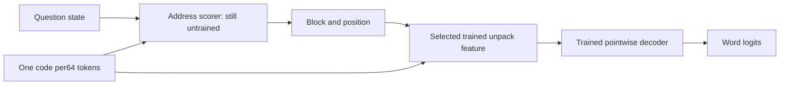

# Trained selective decoder: verified oracle word recovery

**The codec can read a single requested word without expanding64 positions into
language-model attention.** Reusing its trained nonlinear decoder works; the
language model still needs to learn which block and position to request. This is
a verified COMPONENT result, not factual QA, reasoning or final quality parity.
The full goal remains active and unmet. Native256 and completed runs are intact.

Source components: `src/models/token_memory_64_selective/reader.py`.
Export: `dump/native256-selective-reader-preflight-20261017/readout.pt`.
All probe workers finished; no optimizer was constructed or LM trained here.

## What the reader does

For one256-dimensional code and one requested position0..63:

1. Select that position's125 rows from the trained unpack matrix.
2. Apply the shared125→256 feature map.
3. Apply the trained decoder's one-position residual transformation and FFN.
4. Produce word logits using its trained norm and word table.

With only one key, decoder attention has weight1. Its value/output projections
are fused into one256→256 matrix; query/key projections and softmax disappear.
The result is a position-conditioned nonlinear readout. It does not create64
global attention positions,64 source KV entries or a decoded-history cache.

## Verified accuracy with ORACLE addresses

| Evaluation | Correct |
|---|---:|
| Non-PAD/BOS/EOS development tokens | 32,728/32,728 (100%) |
| Non-PAD/BOS/EOS test tokens | 32,735/32,736 (99.997%) |
| All development tokens | 32,728/32,768 |
| All test tokens | 32,735/32,768 |
| Prior fact-value tokens, eight groups | 2,048/2,048 |
| Zero-code fact controls | 0/2,048 |
| Shuffled-code fact controls | 0/2,048 |

Each fact group scores256/256: fixed and shifted facts, distractors before/after,
both two-record orders, and the eight held answer words. Addresses were derived
from the correct queried record in source text and supplied intentionally. This
therefore does NOT establish entity binding or address generalization. It is one
word per query, not value+EOS free generation. The pretrained decoder already
knows the vocabulary; no claim of words unseen by all pretrained resources.

Fused predictions match the original unfused one-position decoder on every dev
and test position. They match full-context decoder predictions on every test
position; one development disagreement is on a special-token label. Original
codec errors remain, including one non-special test error. Not globally lossless.

Independent audit rederived every source fact position/word, recomputed metrics
and2048 deterministic general-text samples through the ORIGINAL unfused decoder,
and checked all1726 protected hashes. Six CPU tests pass for algebra, future/
blocked masking and gradients, empty-cache handling, storage counts and budgets.

## Query conditioning, cache and parameter costs

An untrained address scorer is implemented. It folds a query's125-dimensional
key through the frozen unpack weights once, then scores all memory codes to
obtain64 scalar addresses per code. Query-dependent offsets can address a value
near a matched name. It adds a NULL classifier outcome and respects per-query
memory visibility. It does not construct64 feature vectors per source code or
enlarge global attention. Its ability to select useful addresses is UNTESTED.

The cache prototype allocates one256-dimensional key and one256-value per code,
plus ordinary lengths. Values hold original FP32 codes; no second code, raw
history, decoded word or feature cache is retained. This proves storage feasibility
only. A real LM must route original codes into an existing value slot: a normally
projected/normalized V is not interchangeable with the original code. Actual
prefill/incremental/rollover parity and complete cache accounting remain required.

Frozen readout3,981,312 parameters; address scorer36,864; combined4,018,176.
Actual parameter-only native-shaped fixtures count23,209,216 by reducing total
FFN rows32467→24619. A second fixture including the actual9,426,432 encoder also
counts23,209,216, with FFN rows6208. These fixtures deliberately have NO usable LM
forward; they prove allocation arithmetic, not quality. The smaller core's
language cost and the final reader-versus-total budget preference remain open.

Complete address-scoring plus forced selected-read component medians:

| Batch | Memory codes | Time |
|---|---:|---:|
| 1 | 1 | 3.802ms |
| 1 | 39 | 4.426ms |
| 16 | 1 | 4.241ms |
| 16 | 39 | 4.319ms |

The selector is RANDOM/UNTRAINED and benchmark queries are fixtures. Timings
include selection/readout operations and their validations, but exclude encoder,
main LM, cache ingestion and integrated generation. They do not establish that
the complete model is faster. Peak prototype allocation.126GiB/reservation.133GiB
likewise does not represent full-model memory. A single selected unpack uses
64,000 MACs; the folded address calculation shares its large query-side map across
codes. Full-model benchmarking must precede training.

## Next required work

Integrate this frozen readout and a TRAINED question-to-address path in a separate
budgeted LM, with the original-code value route and an actual incremental cache.
Train source-derived address labels and NULL/EOS handling alongside language
replay. Test free value+EOS, all-four counterfactual binding, new names/values,
blocked/future controls and full language quality. Then perform fresh matched
two-original-epoch training against a real all-raw reference, including reasoning
and end-to-end efficiency. Oracle recovery cannot substitute for these checks.

The component package/protocol/probe hashes are now frozen in the export.
**Do not edit or add files in `token_memory_64_selective`**, because the export's
source inventory includes that package. Implement future LM integration in a
new sibling package, such as `token_memory_64_selective_lm`, importing these
unchanged components. Do not modify the completed student or native runs.

See [prospective protocol](native256_selective_reader_protocol.md),
[student comparison](native256_word_readout_results.md), and
[full-goal evidence gaps](token_memory_64_goal_status.md).
